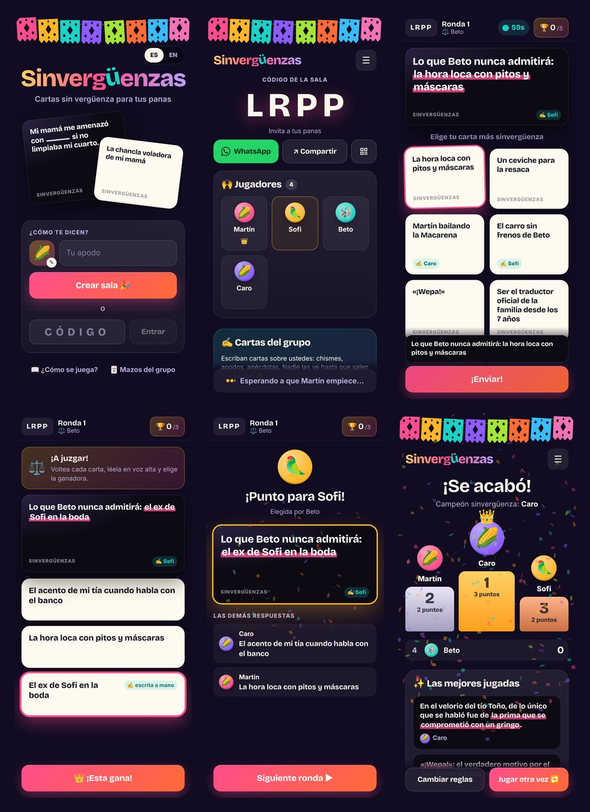

# Sinvergüenzas 🌶️

**Cartas sin vergüenza para tus panas.** A Cards Against Humanity–style party
game with Latino flavor, played on everyone's phone at the same time. Its main
twist is that **your group writes its own cards** (inside jokes, nicknames,
that one story about the tío), and the game makes sure they come up.



## Features

- 🌮 **400+ original Latino cards** in three decks: *Latino Clásico* (familia,
  comida, telenovelas, reguetón, la chancla), *Spanglish*, and *Picante* (+18,
  off by default).
- ✍️ **Personalized cards.** In the lobby, everyone writes prompts and answers
  about the group. They stay secret until they show up in a round, and
  "¿sin ideas?" chips fill templates with your friends' real names.
- 🃏 **Group decks that persist.** Your cards are saved to the group's deck for
  the next game night. Share the deck link so friends can add cards during the
  week.
- 🔥 **Boost.** Custom cards are dealt early so inside jokes actually show up
  among 400 built-in cards.
- ✍️ **Wildcards (comodines).** Write your own answer mid-round. Winning
  write-ins are saved to the deck.
- 📱 **Built for phones.** Big tappable cards, a live preview of your answer
  inside the sentence, synced card flips while the judge reads, haptics,
  confetti, keeps the screen awake, works on notched phones, installable to
  the home screen.
- 🔗 **Join in one tap** via WhatsApp link, share sheet or QR code. No accounts,
  no app install.
- 🔄 **Reconnects by itself.** Refresh, lock the phone or switch apps without
  losing your seat. Reopening the link in another browser with the same name
  takes your seat back.
- ⚙️ **House rules.** Points to win, round timer, hand size, number of
  wildcards, and *Tío Random* 🤖 (a bot who plays random cards; if he beats you,
  qué vergüenza).
- 🌐 Spanish UI with an English toggle.

## How to play

1. **Open a room** and send the link to the group on WhatsApp. Everyone plays on their own phone.
2. **Write cards about each other** in the lobby while people arrive (optional, but that's the fun).
3. Each round one person is the **judge**. Everyone else plays the most shameless card that completes the black card.
4. The judge **flips the anonymous answers, reads them out loud** and crowns the funniest. First to the target score wins.

## Deploy to Vercel (free, about 5 minutes)

You need a [Vercel](https://vercel.com) account and a Redis database. Either
works:

- **Upstash** (free, one click from the Vercel Marketplace), or
- **any Redis connection string**, such as a free [Redis Cloud](https://redis.io/cloud/)
  database (`redis://default:<password>@<host>:<port>`).

### Option A: import this repo

1. On Vercel: **Add New… → Project → Import** `martinpazmino/Cards_NikNsaue`.
   Vercel detects Vite and deploys the `api/` function automatically. Click **Deploy**.
2. Connect the database, using **one** of these:
   - **Upstash:** open **Storage → Create Database → Upstash for Redis → Free**
     and connect it to the project. This adds `KV_REST_API_URL` and `KV_REST_API_TOKEN`.
   - **Your own Redis (for example Redis Cloud):** open **Settings → Environment
     Variables** and add `REDIS_URL` with your connection string, for
     Production and Preview. Vercel's "Redis" Marketplace integration sets
     `REDIS_URL` for you.
3. **Redeploy** (Deployments → ⋯ → Redeploy) so the function picks up the variables.
4. Open the URL, create a room, and send the link to the group. 🎉

> **Share the short production URL** (`https://<project>.vercel.app`). The long
> `…-<team>.vercel.app` deployment URLs sit behind Vercel's login (Deployment
> Protection): friends can't open them, and phones can't install the app from
> them. Invite links inside the app always use the production URL.
>
> **Install it like an app:** open the production URL, then browser menu →
> *Install app* / *Add to Home Screen*.

> Vercel deploys your repo's production branch (usually `main`) to the main URL.
> Merge this work into `main`, or set the branch under **Settings → Git → Production Branch**.

### Option B: Deploy button

This clones the project into your GitHub account and provisions Upstash during setup:

[](https://vercel.com/new/clone?repository-url=https%3A%2F%2Fgithub.com%2Fmartinpazmino%2FCards_NikNsaue&project-name=sinverguenzas&repository-name=sinverguenzas&stores=%5B%7B%22type%22%3A%22integration%22%2C%22integrationSlug%22%3A%22upstash%22%2C%22productSlug%22%3A%22upstash-kv%22%2C%22protocol%22%3A%22storage%22%7D%5D)

**Tips**

- Put the database in the same region as your functions. Vercel's default is
  Washington D.C. (`iad1`), which is AWS `us-east-1`.
- Supported variables: `KV_REST_API_URL` + `KV_REST_API_TOKEN` or
  `UPSTASH_REDIS_REST_URL` + `UPSTASH_REDIS_REST_TOKEN` (Upstash REST), or
  `REDIS_URL` / `KV_URL` (any `redis://` or `rediss://` URL). If both kinds are
  set, Upstash REST wins. See `.env.example`.
- Keep connection strings out of the repo; they belong in Vercel's environment variables.
- If the database isn't connected, the home screen shows a "Falta un pasito ⚙️" notice.

## Run it locally

```bash
npm install
npm run dev      # http://localhost:5173, the API runs inside Vite with an in-memory store
```

No database or account is needed locally. The dev server also listens on your
network, so phones on the same Wi-Fi can join at `http://<your-computer-ip>:5173`.

```bash
npm test               # engine, API, Redis (if redis-server is installed) and i18n tests
npm run build          # production build into dist/
npm start              # serve dist/ + API like production, on http://localhost:3000
npm run e2e            # 4 simulated phones play a full game (needs Playwright + Chromium)
npm run check:cards    # validate the built-in decks
```

To develop against a real database, copy `.env.example` to `.env.local` (it's
git-ignored) and fill in one option, or run `vercel env pull .env.local`. Both
`npm run dev` and `npm start` read it.

## Make it yours

- **Add or edit cards:** `shared/cards/clasico.js`, `spanglish.js` and `picante.js`.
  - Prompts use `___` for each blank (up to 2). Two blanks means "pick 2".
    A prompt without a blank is a question.
  - Answers start lowercase unless they begin with a name or a quote
    («…»), and have no trailing period. The game capitalizes them when needed.
  - Run `npm run check:cards` to catch duplicates and style issues.
- **New deck:** create a file like the others and register it in `shared/cards/index.js`.
- **Default rules:** `DEFAULT_SETTINGS` in `shared/constants.js`.
- **Rename the game:** `APP_NAME` in `shared/constants.js`, plus `index.html`,
  `public/manifest.webmanifest`, the `Logo` in `src/components/ui.jsx` and a
  few strings in `src/lib/strings.js`.
- **Texts and translations:** `src/lib/strings.js` (`npm test` checks every key exists in ES and EN).
- **Icons and link preview:** edit `public/icons/icon.svg` and run `npm run assets` (uses Playwright).

## How it works

A static React app plus one Vercel Function, with game state in Redis. The
server is authoritative: phones send moves, the server validates them, and
each phone only receives what its player is allowed to see. Phones poll a tiny
version number about once a second, served from the CDN, and download the
full state only when it changes. The full design (why not WebSockets,
consistency, security, costs) is in [docs/ARCHITECTURE.md](docs/ARCHITECTURE.md).

```text
api/index.js          Vercel Function: every /api/* request
server/handler.js     HTTP routing, errors, CDN cache headers
server/rooms.js       rooms & decks: auth, compare-and-swap writes, deck sync
server/store.js       Redis store (Upstash REST or REDIS_URL, Lua CAS) + in-memory store
shared/game.js        pure game engine (state machine)
shared/view.js        per-player view (what each phone may see)
shared/text.js        blanks, filling prompts with answers
shared/cards/         the decks
src/                  React app (screens, components, sync hook, i18n, styles)
test/                 node:test suites
scripts/              dev server, e2e, card/i18n checks, asset generator
```

## Costs

Everything fits in free tiers for a group of friends. A 2-hour, 8-player night
uses about 40K Redis commands: Upstash's free plan includes 500K per month, and
on a Redis Cloud free database a room takes only tens of KB, with one
connection per running function.
See [docs/ARCHITECTURE.md](docs/ARCHITECTURE.md#cost-on-free-tiers).

## Credits

Game mechanics inspired by [Cards Against Humanity](https://www.cardsagainsthumanity.com/).
All cards in this repo are original, and this project is not affiliated with
Cards Against Humanity LLC. Made for playing with friends, not for sale.
