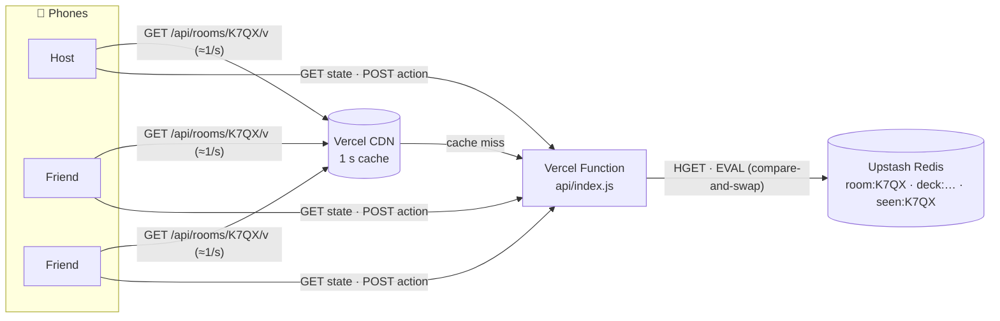
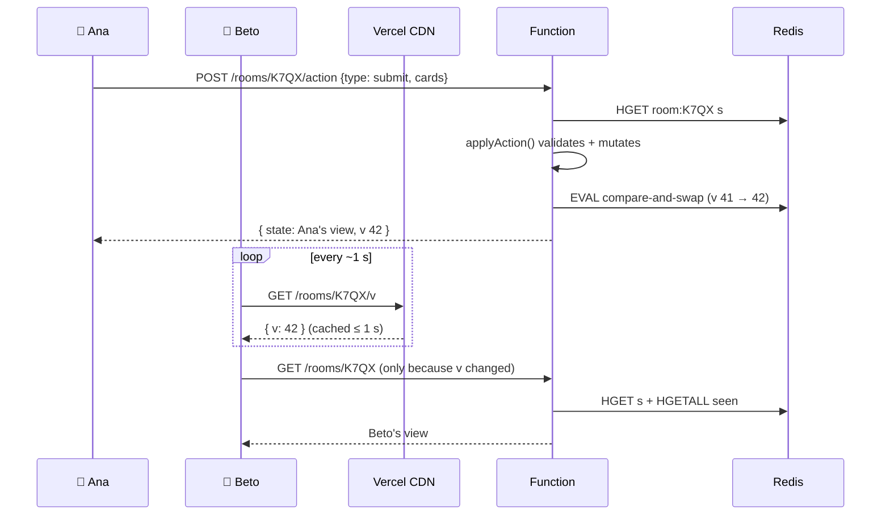
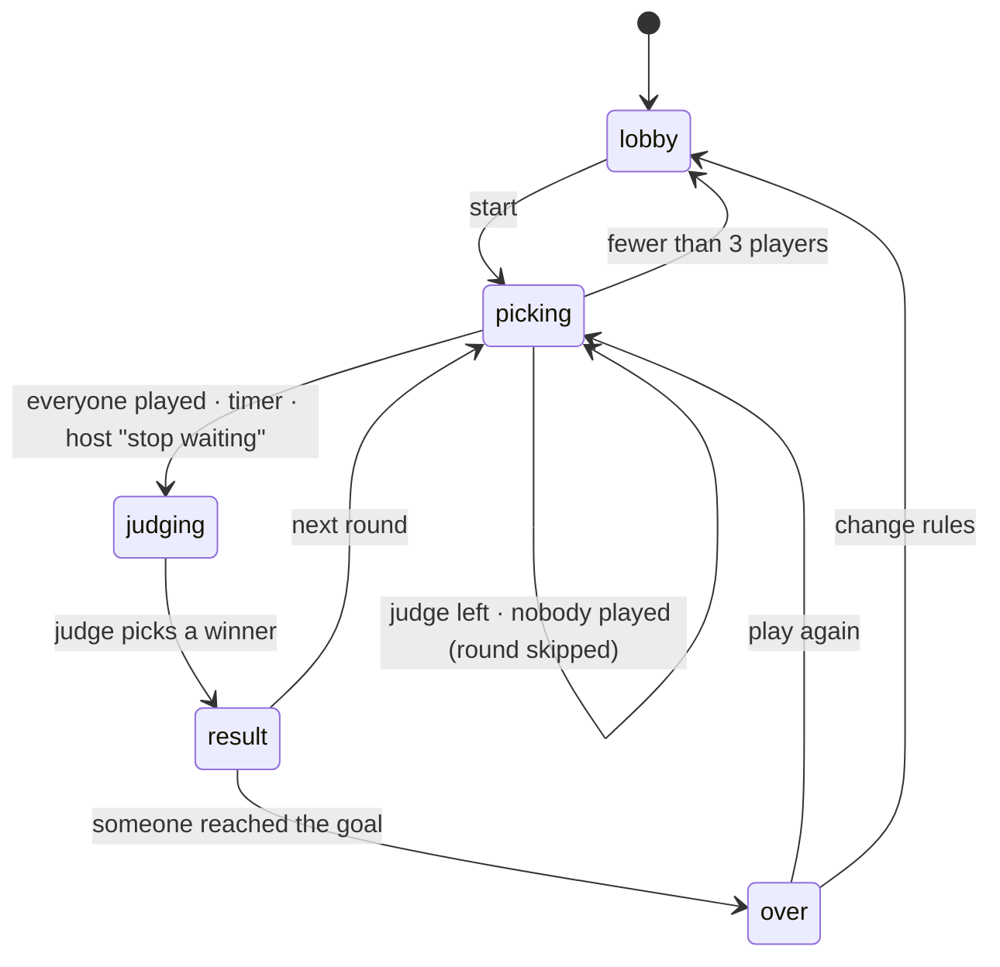

# Architecture

Sinvergüenzas is a real-time party game: 3–16 phones in the same room (or on a
video call) play Cards Against Humanity–style rounds. The goals that shaped
the design:

1. **Deploys on Vercel with one free database**, with no servers to babysit.
2. **Feels live on phones**: changes show up on everyone's screen within about a second.
3. **Nobody can cheat by poking the API**: hands stay secret and votes stay anonymous.
4. **Survives real phone behavior**: locked screens, app switching, flaky 4G,
   opening the WhatsApp link in a different browser.
5. **Personal cards are the point**: what a group writes must persist and show up in the game.

## The short version

- **Frontend:** React + Vite, served as static files from Vercel's CDN.
- **Backend:** a single Vercel Node.js Function (`api/index.js`) for every `/api/*` route.
- **State:** Upstash Redis (Vercel Marketplace), with one JSON document per room and per group deck.
- **Game logic:** a pure, deterministic state machine in `shared/game.js`. The server is
  authoritative: clients send *intents* ("play these cards") and the server
  validates them against the real state.
- **Real time:** *version polling*. Each phone polls a tiny version number
  about once a second, served from the CDN with a 1-second cache. It downloads
  its personalized state only when that number changes. A phone that makes a
  move gets the new state back in the same response.



## Why polling and not WebSockets?

As of late 2026, Vercel Functions support WebSockets in **public beta** on Fluid
Compute ([docs](https://vercel.com/docs/functions/websockets)). Two properties
of that model matter for a multiplayer room:

- A connection is **pinned to one function instance**. Players in the same room
  can land on different instances, so broadcasting a move to everyone needs a
  separate pub/sub layer (for example Redis pub/sub over TCP) and code to fan
  messages out.
- A connection **closes when the function hits its maximum duration**, so
  clients must reconnect and resync anyway.

A turn-based card game doesn't need sub-100 ms latency: a move showing up
within about a second is plenty when everyone is laughing in the same living
room. Polling a cached version number gives that with:

- **No connection state at all.** Any request can hit any instance, a cold
  start or deploy loses nothing, and a phone that slept for 10 minutes just
  polls again.
- **Cheap reads.** The version endpoint returns `{ "v": 42 }` with
  `Vercel-CDN-Cache-Control: max-age=1`. However many phones are polling, the
  function and Redis see roughly one request per second per room (per CDN
  region). The minimum CDN TTL is 1 second
  ([docs](https://vercel.com/docs/caching/cache-control-headers)).
- **Instant feedback for the actor.** Every action's response carries the new
  state, so the person who tapped sees the result immediately. Everyone else
  sees it on their next poll, about a second later.

The client sends version polls with the browser's default cache mode on
purpose. `cache: 'no-store'` makes browsers add `Cache-Control: no-cache` to the
request, which could make the CDN skip its cache.

**Upgrade path:** if lower latency is ever needed, the "version changed" signal
can move to push (Vercel WebSockets once GA, Ably/Pusher, or Supabase Realtime)
without touching the game engine. Only `src/lib/useRoom.js` changes.

## Data model

All documents are Redis **hashes** with two fields: `v` (version, an integer)
and `s` (the JSON snapshot). Polling reads only `v`.

| Key | Contents | Lifetime |
|---|---|---|
| `room:{CODE}` | Room state: players + secret tokens, settings, hands, piles, current round, history, the room's custom cards, recent events | 12 h, refreshed on every write |
| `seen:{CODE}` | Presence hash `playerId → last ping (ms)` | 12 h |
| `deck:{id}` | Group deck: name + custom cards `{id, t: 'p'\|'a', text, by, at}` | 1 year, refreshed on use |

Room codes are 4 letters from a 20-consonant alphabet (`BCDF…XZ`): 160,000
combinations, easy to say out loud, and no accidental words. Built-in cards are
referenced by short ids derived from a hash of their text (`cl.p1x9k2`), so
editing the decks between deploys never shows the wrong text.

### Optimistic concurrency

Several players often act in the same second (everyone submits at once). Every
write is a **compare-and-swap**: read the document, apply the action in
JavaScript, then save only if the version is unchanged. Otherwise retry with a
small jittered backoff:

```lua
-- KEYS[1] = room key, ARGV = expected v, new v, new JSON, TTL
if redis.call('HGET', KEYS[1], 'v') ~= ARGV[1] then return 0 end
redis.call('HSET', KEYS[1], 'v', ARGV[2], 's', ARGV[3])
redis.call('EXPIRE', KEYS[1], ARGV[4])
return 1
```

`test/redis.test.js` runs this against a real `redis-server` (through a small
shim that speaks Upstash's REST protocol) with eight players submitting at the
same time. Every submission lands, and conflicts are retried rather than lost.

## Request flow



Other details of the client sync loop (`src/lib/useRoom.js`):

- It **pauses while the tab is hidden** and resyncs immediately on
  `visibilitychange`, `focus` and `online`, so locked phones cost nothing.
- Every 15 s it fetches the state with an `x-ping: 1` header. That records
  presence, which drives the "offline" badges and seat recovery. It's a header
  rather than a query parameter so it always survives the `/api/*` rewrite.
- It backs off exponentially on network errors and shows a "reconnecting" banner.
- **Deadlines** (round timer, result screen) are enforced lazily. Serverless
  has no background timers, so any client whose clock (corrected by the server
  time in each response) passes a deadline sends an idempotent `tick`, and the
  server checks the deadline against its own clock.

## The game engine

`shared/game.js` is plain functions over a JSON document, with time and
randomness injected (`ctx = { now, rng }`). That makes it deterministic and easy
to test: `test/game.test.js` plays whole games and checks invariants such as "no
answer card is ever lost or duplicated".



Rules worth knowing:

- **Judge rotation** follows join order and skips the bot. If the judge leaves
  mid-round, the round is cancelled and played cards return to their owners.
- **Pick-2 prompts** (two blanks) take two cards, in order.
- **Wildcards** (comodines) let a player write an answer mid-round. A winning
  write-in is saved to the group deck.
- **Tío Random** is an optional bot that plays random cards every round
  (a classic house rule).
- **Running out of cards** reshuffles the discard pile.
- **Seat recovery:** joining with the name of a player who has been offline
  for 35 s or more takes over their seat (same hand and score). This covers
  "I opened the link in Safari instead of WhatsApp's browser".

### What each player can see

The server never sends the raw state. `shared/view.js` builds a personalized
view per request:

- your own hand only; other hands are never sent
- submissions are **anonymous** during judging (no player ids), and stay face
  down until the judge flips them (flips are synced to every phone)
- authors are revealed only on the result screen
- custom cards in the lobby: you see yours, and everyone sees only counts
  (they're a surprise)
- player tokens never leave the server, except to their owner on join

## Personalized cards

This is the feature that makes the game about *your* friends:

1. **In the lobby**, everyone writes prompts and answers. A live card preview
   shows how it will look, and "no ideas?" chips fill templates with real
   names from the room ("El talento oculto de Beto: ___").
2. **Boost:** custom cards are shuffled near the top of the draw piles (about
   1 custom per 1–1.5 built-in cards) so inside jokes actually come up instead
   of drowning among 400 built-in cards.
3. **Group decks:** the first custom card creates a persistent deck
   (`deck:{id}`). Every card written in the room, plus winning write-ins, is
   mirrored there. Next time, creating a room with that deck loads all the
   cards. The deck page (`/m/{id}`) lets friends add cards during the week,
   before game night.

## Security and privacy

- **No accounts.** A player is a random id plus a 144-bit token kept in
  `localStorage`. All mutations require the token.
- **Minimal data:** nicknames, emoji avatars and the cards people write.
  Rooms expire after 12 idle hours. Decks expire after a year without use.
- **Anyone with a deck link can edit that deck**, like a shared document. This
  is intentional for friend groups.
- **Input limits:** names 16 chars, prompts 160, answers 90, control
  characters stripped, at most 2 blanks per card, 800 custom cards per room,
  2,000 per deck, 32 KB request bodies. React escapes all rendered text.

## Cost on free tiers

For a 2-hour night with 8 players (about 50 rounds):

| Source | Redis commands |
|---|---|
| Version polls that miss the CDN (≈1/s per room) | ~7K |
| Full state downloads after changes (2 commands each) | ~13K |
| Presence pings (every 15 s, 4 commands each) | ~15K |
| Actions (≈3 commands each) | ~2–3K |
| **Total** | **~40K** (≈90K if the CDN cache were bypassed) |

Upstash's free tier includes 500K commands/month
([pricing](https://upstash.com/pricing/redis)), roughly 5–12 such nights.
Beyond that, pay-as-you-go is $0.20 per 100K commands. On Vercel, most polls
are CDN hits, which count as edge requests rather than function invocations.

## Testing

| Layer | What | Where |
|---|---|---|
| Content | No duplicate cards, valid blanks, lengths, style | `scripts/check-cards.js`, `test/game.test.js` |
| Engine | Full games, rotation, pick-2, wildcards, timers, leaving/kicking, bot, boost, reshuffle, view secrecy | `test/game.test.js` |
| HTTP API | Every route, auth, errors, concurrent submits, Vercel-rewritten URLs, deck persistence | `test/api.test.js` |
| Redis | Lua compare-and-swap, TTLs, presence, 8 concurrent writers, against real Redis | `test/redis.test.js` |
| i18n | Every UI string exists in ES and EN | `test/i18n.test.js` |
| End-to-end | 4 phones (one small) play a whole game with a reload mid-game; screenshots every screen | `scripts/e2e.js` |

## Inspiration

- [Cards Against Humanity](https://www.cardsagainsthumanity.com/) for the
  mechanics. All cards here are original; this project is not affiliated with
  CAH LLC.
- [Massive Decks](https://github.com/Lattyware/massivedecks), an open-source
  CAH clone with custom decks: the idea of decks that live outside a game.
- Jackbox-style "phones as controllers" party games: join by room code, no app install.
